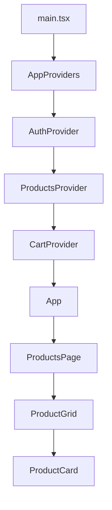

> **Actualización de desarrollo:** consultá [la etapa 1](docs/ETAPA-1.md) para la configuración actual y el plan de trabajo. Las secciones de homework siguientes conservan documentación histórica.

## Bitácora de IA — trabajo verificado

| Fecha | Tema | Aporte de IA y decisión | Evidencia / verificación |
|---|---|---|---|
| 2026-11-06 | Revisión y resolución de configuración | Se contrastó `API_KEY_INVALID` con el código. Se decidió validar variables vacías antes de inicializar Firebase, sin afirmar que eso valide la clave ante Google. | `src/config/environment.ts`, `src/main.tsx` y tests de configuración. Pendiente comprobar la configuración real de Firebase. |

Se agregarán entradas a medida que se completen decisiones y verificaciones reales.

# E-commerce de Productos Naturales 🌿🥜

## Proyecto Integrador — Módulo 5
### Homework Clase 1: E-commerce Kickoff

Aplicación desarrollada con **React, TypeScript y Vite**, cuyo objetivo es establecer las bases arquitectónicas de una tienda online de productos naturales y frutos secos.

Esta primera etapa se enfoca en la organización del proyecto, el tipado de datos, la administración del estado global mediante Context API y la integración entre diferentes dominios.

El proyecto está pensado para evolucionar progresivamente durante el módulo.

## 1. Tecnologías utilizadas

- React
- TypeScript
- Vite
- Context API
- Custom Hooks
- Vitest
- React Testing Library
- jsdom

## 2. Estructura del proyecto

```text
src/
├── components/
│   ├── ProductCard.tsx
│   └── ProductGrid.tsx
├── contexts/
│   ├── AuthContext.tsx
│   ├── ProductsContext.tsx
│   └── CartContext.tsx
├── hooks/
│   ├── useAuth.ts
│   ├── useProducts.ts
│   └── useCart.ts
├── mocks/
│   └── henryProducts.ts
├── pages/
│   └── ProductsPage.tsx
├── providers/
│   └── AppProviders.tsx
├── services/
│   └── productsService.ts
├── tests/
│   ├── useCart.test.tsx
│   └── CartIntegration.test.tsx
├── types/
│   ├── product.ts
│   ├── cart.ts
│   └── user.ts
├── App.tsx
└── main.tsx
```

### Responsabilidades de las carpetas

| Carpeta | Responsabilidad |
|---|---|
| `components/` | Contiene componentes reutilizables de la interfaz. |
| `pages/` | Organiza las páginas principales de la aplicación. |
| `contexts/` | Define los estados globales y sus Providers. |
| `hooks/` | Centraliza el acceso a los Contexts mediante custom hooks con guards. |
| `providers/` | Compone los Providers en el orden requerido. |
| `services/` | Centraliza el acceso a los datos del catálogo. |
| `types/` | Define los contratos de datos utilizados por la aplicación. |
| `mocks/` | Contiene datos de ejemplo para desarrollo y pruebas. |
| `tests/` | Contiene pruebas automatizadas de comportamiento e integración. |

Esta separación permite mantener responsabilidades claras y facilita la incorporación de nuevas funcionalidades sin concentrar toda la lógica en un único componente.

## 3. Modelo de datos

Se definieron tres interfaces principales.

### Product

Representa un producto del catálogo.

Incluye:

- `id`: identificador único.
- `name`: nombre del producto.
- `price`: precio.
- `stock`: unidades disponibles.
- `category`: categoría.
- `rating?`: calificación opcional.
- `imageUrl?`: imagen opcional.

Los campos opcionales permiten representar productos que todavía no tienen calificación o imagen.

### CartItem

Representa un producto agregado al carrito.

Incluye:

- `productId`: referencia al producto.
- `quantity`: cantidad seleccionada.

Se utiliza `productId` en lugar de duplicar toda la información del producto dentro del carrito.

### User

Representa un usuario de la aplicación.

Incluye:

- `id`
- `name`
- `email`
- `role`

El rol está restringido mediante un tipo unión a `"customer"` o `"admin"`.

## 4. Estado global con Context API

Se implementaron tres Contexts.

### AuthContext

Administra la autenticación del usuario.

Expone:

- `user`
- `isAuthenticated`
- `login()`
- `logout()`

### ProductsContext

Administra el catálogo de productos y expone `products`.

En esta primera etapa utiliza información mockeada, sin conexión a una API externa.

### CartContext

Administra los productos agregados al carrito.

Expone:

- `items`
- `addToCart()`
- `removeFromCart()`
- `clearCart()`

También consulta `useAuth()` para detectar cambios de usuario y vaciar el carrito cuando corresponde.

## 5. Árbol de Providers



### Justificación del orden

El orden de composición utilizado es:

1. `AuthProvider`
2. `ProductsProvider`
3. `CartProvider`

`AuthProvider` se ubica en el nivel superior porque la autenticación puede ser necesaria para otros dominios.

`ProductsProvider` administra el catálogo y queda disponible para los componentes descendientes.

`CartProvider` se encuentra dentro de `AuthProvider` porque utiliza `useAuth()` para consultar al usuario autenticado.

Este orden permite compartir información entre dominios sin transmitirla manualmente a través de múltiples componentes.

## 6. Custom Hooks y Guards

Se implementaron tres custom hooks:

- `useAuth()`
- `useProducts()`
- `useCart()`

Cada hook utiliza `useContext()` para acceder a su Context correspondiente.

Además, incluye un guard que arroja un error cuando se intenta utilizar fuera del Provider.

Ejemplo:

```ts
if (context === undefined) {
  throw new Error(
    "useCart debe utilizarse dentro de CartProvider"
  );
}
```

Esta protección permite detectar errores de implementación y facilita la depuración.

## 7. Integración entre Contexts

Se implementó una integración real entre `AuthContext` y `CartContext`.

`CartProvider` utiliza `useAuth()` para conocer el usuario actual.

Cuando un usuario autenticado cierra sesión o cambia por otro usuario, el carrito se vacía.

Esta integración demuestra cómo un Provider puede acceder a información de otro dominio sin necesidad de prop drilling.

En esta etapa no se implementó persistencia del carrito en una base de datos ni en almacenamiento local.

## 8. Demostración de anti-prop drilling

La interfaz utiliza la siguiente jerarquía:

```text
ProductsPage
    └── ProductGrid
            └── ProductCard
```

`ProductGrid` consulta `useProducts()` para obtener el catálogo.

Cada `ProductCard` recibe el producto que debe mostrar, pero obtiene `addToCart()` directamente mediante `useCart()`.

Por lo tanto, no es necesario pasar las funciones del carrito a través de `ProductsPage` y `ProductGrid`.

Se mantienen las props para los datos específicos de cada componente y se utiliza Context API para compartir el estado global.

## 9. Productos de ejemplo

La aplicación está personalizada como una tienda de productos naturales y frutos secos.

El catálogo inicial incluye:

- Almendras Naturales 250 g.
- Nueces Mariposa 250 g.
- Mix de Frutos Secos 500 g.

Los precios, stocks y calificaciones utilizados son datos ficticios para el desarrollo académico.

Además, se conserva un conjunto separado de ejemplos solicitados por Henry:

- `p1` — Zapatillas Runner Pro.
- `p2` — Mochila Ergonómica.
- `p3` — Auriculares ANC.

Esta separación permite mantener la identidad del proyecto sin perder los ejemplos académicos de referencia.

## 10. Tests automatizados

Se implementaron dos pruebas con Vitest y React Testing Library.

### Test 1: Guard de useCart

Archivo: `src/tests/useCart.test.tsx`

Comprueba que `useCart()` arroje el error esperado cuando se utiliza fuera de `CartProvider`.

### Test 2: Integración entre autenticación y carrito

Archivo: `src/tests/CartIntegration.test.tsx`

Comprueba que:

1. Un usuario pueda iniciar sesión.
2. Se pueda agregar un producto al carrito.
3. Al cerrar sesión, el carrito quede vacío.

Ambos tests se ejecutaron correctamente.

Para ejecutar las pruebas:

```bash
npm run test
```

O directamente:

```bash
npm exec vitest run
```

## 11. Bitácora de IA

Durante el desarrollo se utilizó ChatGPT como herramienta de apoyo para revisar el diseño de tipos, la organización de los Providers, la integración entre Contexts y la implementación de pruebas.

Las decisiones se evaluaron considerando los requisitos de la homework y el alcance académico del proyecto.

### Iteración 1 — Revisión del modelo de datos

**Prompt utilizado:**

> Revisá las interfaces TypeScript Product, CartItem y User de un e-commerce desarrollado con React y Context API. Evaluá los campos, la opcionalidad, las relaciones entre entidades y los nombres utilizados. Proponé mejoras que mantengan el proyecto sencillo, porque se trata de un kickoff académico y no de un e-commerce de producción.

**Sugerencia de la IA:**

Mantener identificadores claros, utilizar propiedades opcionales cuando los datos no sean obligatorios y relacionar los elementos del carrito con el catálogo mediante `productId`.

También se señalaron posibles mejoras futuras, como validar cantidades, tipar categorías de manera más estricta y agregar variantes de presentación.

**Criterio humano:**

Se decidió mantener las interfaces actuales porque representan correctamente los datos necesarios para esta etapa.

Se conservaron `rating?` e `imageUrl?` como opcionales y se mantuvo `productId` como referencia al catálogo.

**Resultado aplicado:**

Se validó el diseño existente y se decidió conservarlo sin agregar campos innecesarios.

**Resultado descartado:**

No se incorporaron variantes de peso, descuentos, direcciones ni entidades de pago, porque exceden los requisitos de esta homework.

### Iteración 2 — Revisión de la composición de Providers

**Prompt utilizado:**

> Auditá una arquitectura React con tres Providers anidados en este orden: AuthProvider → ProductsProvider → CartProvider. CartProvider utiliza useAuth() para vaciar el carrito cuando cambia el usuario. Evaluá el orden, los riesgos de re-render, el acoplamiento entre Contexts y posibles mejoras sin introducir librerías adicionales.

**Sugerencia de la IA:**

Mantener `AuthProvider` por encima de `CartProvider` para que este último pueda acceder correctamente a `useAuth()`.

Se identificó que los objetos y funciones proporcionados mediante Context pueden generar nuevas referencias durante los renderizados, y que herramientas como `useMemo()` y `useCallback()` podrían ser útiles si aparecen problemas de rendimiento.

También se recomendó mantener explícita la dependencia entre autenticación y carrito.

**Criterio humano:**

Se aceptó mantener el orden obligatorio y la integración mediante `useAuth()`.

Se decidió no agregar optimizaciones prematuras, ya que el proyecto es pequeño y todavía no presenta una necesidad demostrada de optimización.

**Resultado aplicado:**

Se conservó el orden de `AppProviders` y la lógica de limpieza del carrito ante cambios del usuario.

La integración se verificó mediante un test automatizado.

**Resultado descartado:**

No se incorporó Redux ni una capa adicional de administración de estado. Context API resulta suficiente para esta etapa.

### Revisión de la integración entre useAuth, useCart y useProducts

La IA también se utilizó para revisar las dependencias entre dominios.

Se comprobó que:

- `CartProvider` accede a autenticación mediante `useAuth()`.
- `ProductsContext` administra el catálogo sin depender de la autenticación.
- `ProductGrid` obtiene los productos mediante `useProducts()`.
- `ProductCard` utiliza `useCart()` directamente.
- Los componentes no necesitan recibir funciones globales del carrito a través de varios niveles de props.

Esta distribución mantiene responsabilidades separadas y evita dependencias innecesarias.

## 12. Qué hice distinto y por qué

Respecto de los ejemplos de clase, se tomaron las siguientes decisiones:

**Personalización del catálogo:** se eligió una tienda de productos naturales y frutos secos para desarrollar una aplicación con una identidad propia que pueda ampliarse durante el módulo.

**Separación de hooks:** cada Context tiene su custom hook con guard para centralizar el acceso y detectar usos incorrectos.

**Integración entre dominios:** se implementó el vaciado del carrito al cerrar sesión para demostrar una interacción real entre autenticación y carrito.

**Tests automatizados:** se incorporaron pruebas del guard y de la integración entre Providers para validar comportamientos concretos.

**Alcance controlado:** se evitó agregar funcionalidades de producción, como pagos, persistencia, autenticación real o gestión avanzada de stock, porque todavía no forman parte de los objetivos de esta etapa.

## 13. Instalación y ejecución

Clonar el repositorio e instalar dependencias:

```bash
npm install
```

Iniciar el servidor de desarrollo:

```bash
npm run dev
```

Ejecutar los tests:

```bash
npm exec vitest run
```

Verificar la compilación:

```bash
npm run build
```

## 14. Próximos pasos

La arquitectura construida permite continuar incorporando funcionalidades al mismo proyecto en las siguientes clases del módulo.

Entre las posibles ampliaciones se encuentran la búsqueda y filtrado de productos, las variantes por peso, la persistencia del carrito y la conexión con servicios externos, siempre de acuerdo con los requisitos de las próximas consignas.

---

**Estado de la Homework 1:** arquitectura implementada, Contexts y hooks integrados, demostración anti-prop drilling y dos tests aprobados.

## Homework 2 — Sistema de Blog

### Modelado de datos

El blog está compuesto por tres entidades:

- **Author:** representa a la persona que escribe artículos.
- **Post:** representa una publicación y contiene `authorId` como referencia a su autor.
- **Comment:** representa un comentario asociado a un artículo mediante `postId`.

Relaciones:

- Un autor puede escribir muchos posts.
- Cada post pertenece a un autor.
- Un post puede recibir muchos comentarios.
- Cada comentario pertenece a un post.

### Decisión NoSQL: referencia del autor

Se decidió almacenar `authorId` dentro de cada post, en lugar de duplicar el nombre y la foto del autor.

**Justificación:** evita duplicación de datos y facilita mantener actualizada la información del autor. La desventaja es que, para mostrar sus datos completos, se necesita consultar también el documento correspondiente al autor.

### Decisión NoSQL: almacenamiento de comentarios

Se eligió modelar los comentarios como una subcolección de cada post:

```text
posts/{postId}/comments/{commentId}
```

Esta estructura permite consultar los comentarios de un artículo específico de manera directa y mantiene una organización clara.

Como alternativa, se evaluó una colección independiente `comments`, donde cada comentario tendría un campo `postId`.

Ambas opciones son escalables en Firestore. La colección independiente puede resultar conveniente para consultas y moderación global, mientras que las subcolecciones se ajustan mejor al acceso habitual de nuestro blog.

**Decisión final:** utilizar subcolecciones, priorizando la organización por artículo y evitando complejidad innecesaria.

### Bitácora de uso de IA

**Prompt utilizado:**

> En un blog de productos naturales desarrollado con React y TypeScript, ¿conviene guardar los comentarios como subcolección de cada post o como colección independiente en Firestore? Compará ventajas y desventajas de ambas alternativas, considerando consultas, escalabilidad y mantenimiento. Recomendá una opción sin agregar complejidad innecesaria.

**Análisis recibido:**

La IA comparó ambas alternativas considerando las consultas, la escalabilidad, la organización y el mantenimiento. También señaló que Firestore permite realizar consultas de grupo de colecciones y que eliminar un post no elimina automáticamente sus subcolecciones.

| Sugerencia de IA | Decisión | Justificación |
|---|---|---|
| Utilizar subcolecciones por post | Acepto | Se adapta a la consulta habitual de comentarios por artículo. |
| Considerar una colección independiente para moderación global | No implementar por ahora | El proyecto todavía no requiere un sistema de moderación centralizado. |
| Contemplar la eliminación de subcolecciones al borrar posts | Acepto como consideración futura | Firestore no elimina automáticamente los documentos de las subcolecciones. |

### Estado de implementación

El archivo `src/services/blogService.ts` implementa:

- `getPosts()`
- `getPostsByAuthor(id)`
- `addComment(postId, comment)`
- `getCommentsByPost(postId)`, como función adicional.

Actualmente se utilizan datos simulados almacenados en memoria. **La estructura de subcolecciones es una decisión de diseño para una futura implementación con Firestore; todavía no existe persistencia real.**

## Documentación del uso de IA — UI Kit

### Objetivo

Durante el desarrollo del UI Kit se utilizó ChatGPT como herramienta de apoyo para diseñar, implementar y revisar componentes reutilizables en React y TypeScript.

El objetivo fue construir componentes con responsabilidades claras, propiedades tipadas y comportamientos verificables desde una página Playground.

### Consulta 1 — Diseño de componentes reutilizables

**Resumen de la consulta realizada:**

¿Cómo podemos implementar componentes Button y ProductCard reutilizables en React y TypeScript, diferenciando sus variantes mediante propiedades tipadas y evitando combinaciones inválidas?

**Orientación obtenida:**

Se propuso utilizar uniones discriminadas de TypeScript para distinguir las variantes de cada componente.

En Button, la propiedad `variant` permite diferenciar botones de acción (`solid`) y enlaces (`link`).

En ProductCard, la propiedad `layout` distingue las presentaciones `grid` y `list`.

**Decisión aplicada:**

Se implementaron componentes reutilizables que reciben sus datos y comportamientos mediante props.

### Consulta 2 — Validación del UI Kit

**Resumen de la consulta realizada:**

¿Cómo podemos comprobar que los componentes del UI Kit funcionan correctamente sin depender todavía de Firebase, Firestore ni del carrito definitivo?

**Orientación obtenida:**

Se propuso crear una página Playground para probar los componentes de forma aislada, mediante datos de ejemplo, callbacks y controles de estado.

**Decisión aplicada:**

Se implementó una página Playground que permite comprobar:

- Variantes y tamaños de Button.
- Estado de carga y desactivación del botón.
- Presentaciones grid y list de ProductCard.
- Estados Loading, Empty, Error y Success.
- Apertura y cierre de modales.
- Ejecución de callbacks mediante mensajes de confirmación.

### Tabla de decisiones técnicas

| Decisión | Alternativas consideradas | Resultado |
|---|---|---|
| Tipado de variantes | Uniones discriminadas o props opcionales sin restricciones | Se eligieron uniones discriminadas para evitar combinaciones inválidas. |
| Responsabilidad de ProductCard | Incorporar lógica del carrito dentro del componente o recibir un callback | Se eligió `onAddToCart` para mantener el componente independiente del contexto y los servicios. |
| Validación de componentes | Conectar directamente todos los componentes con servicios reales o utilizar un Playground | Se descartó la dependencia inmediata de servicios reales y se eligió un Playground con datos de ejemplo. |

### Verificación

Se realizaron pruebas manuales en el navegador para comprobar el comportamiento de los componentes.

Se verificó el cambio entre las presentaciones de ProductCard, el estado de carga de Button, la visualización de los distintos estados de interfaz y la apertura de los modales.

Los botones ejecutan callbacks y muestran mensajes de confirmación. Estas pruebas permiten validar la interfaz antes de integrar los servicios definitivos del e-commerce.

### Conclusión

La IA se utilizó como apoyo para comprender las alternativas de diseño y revisar la implementación.

Las decisiones se aplicaron en el proyecto y los componentes se probaron manualmente en el navegador.

El UI Kit queda preparado para reutilizarse durante la integración del catálogo, el carrito y las funcionalidades administrativas.
