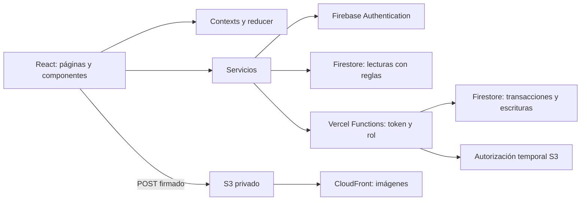

# Presentación y defensa de Tienda Cumbre

Duración sugerida: 8 a 10 minutos. Usar https://tienda-natural-cumbre.vercel.app como enlace de entrega. Preparar una cuenta cliente, una administradora y un producto de prueba antes de empezar.

## 1. Problema y contexto — 45 segundos

**En pantalla:** catálogo y marca.

**Qué explicar:** “Cumbre vende productos naturales. El proyecto lleva el catálogo a una tienda donde el cliente puede elegir productos y registrar un pedido, y la administradora gestiona precios, stock, imágenes y órdenes. La identidad parte de los flyers del emprendimiento.”

Aclarar que el pago es simulado y no se efectúan cobros. La propietaria opera el panel; la configuración de servicios y despliegues pertenece al mantenimiento técnico.

## 2. Arquitectura — 1 minuto

**En pantalla:** estructura de carpetas y este recorrido:

**Qué explicar:** Context comparte sesión, productos y carrito; el reducer define las transiciones del carrito. Las páginas coordinan la interfaz, los servicios acceden a datos y las funciones validan operaciones sensibles. Se eligió esta estructura para separar responsabilidades sin agregar una biblioteca de estado innecesaria.

## 3. Recorrido del cliente — 2 minutos

**Demostración:**

1. Buscar un producto, filtrar por categoría y abrir su detalle.
2. Agregar una unidad y modificar su cantidad en el carrito.
3. Ingresar como cliente y confirmar una compra de prueba.
4. Mostrar la orden en Mis compras y abrir su detalle.

**Qué explicar:** el total del navegador es informativo; el servidor vuelve a leer precios y stock. La orden conserva una copia de los artículos para que un cambio futuro del catálogo no altere esa compra. El carrito vive en Context; recargar lo reinicia.

## 4. Administración e imágenes — 2 minutos

**Demostración:**

1. Ingresar con la cuenta administradora.
2. Crear un producto de prueba con imagen, modificarlo y eliminarlo.
3. Abrir órdenes y cambiar el estado de un pedido de prueba.

**Qué explicar:** el backend comprueba el rol del token, no confía en que un enlace esté oculto. Para subir imágenes genera un formulario POST prefirmado con tiempo y tamaño limitados; el archivo va directamente a S3 y su referencia se guarda en el producto. CloudFront sirve la imagen.

Completar una orden mantiene el stock descontado. Cancelarla debe reponerlo una sola vez. No presentar la reposición manual del stock usada durante nuestras pruebas como si fuera automática por completar.

## 5. Parte desafiante: consistencia de compra — 1 minuto

**En pantalla:** transacción de `api/checkout.ts`.

**Qué explicar:** creación de orden y descuento de stock ocurren juntos. El identificador de solicitud y la huella del carrito evitan procesar dos veces un reintento idéntico. El navegador envía IDs y cantidades; los precios válidos salen de Firestore.

Señalar validaciones de cantidades, productos repetidos y stock insuficiente. Distinguir el control visual del frontend de la validación autoritativa del servidor.

## 6. Pruebas — 1 minuto

**En pantalla:** resultado previamente obtenido de `npm run check` o CI del último commit.

**Qué explicar:** “Tenemos 76 tests en 7 archivos: reducer, hooks, integración de contexts, checkout y endpoints. Los providers de prueba permiten montar varios contexts; Firebase y AWS se simulan para no depender de servicios externos.”

Además hay una comprobación real de carga de Firebase Admin y conversión de clave RSA, sin credenciales ni red. Las pruebas manuales del despliegue se registran aparte: pasar mocks no garantiza que claves, dominios y CORS estén correctos.

## 7. IA y resolución de problemas — 1 minuto

**En pantalla:** tabla de bitácora del README.

Elegir dos ejemplos reales:

- Una propuesta de separación de bundles redujo tamaños, pero rompió Firebase en el navegador. Se retiró después de comprobar el error. Aprendizaje: compilar no equivale a funcionar.
- El checkout serverless falló por require/ESM. Se leyó el log del servidor, se reprodujo el fallo, se acotó el cambio de dependencia y se añadió una comprobación que no usa mocks.
- La carga de imágenes respondía 204, pero el navegador no podía leerla por CORS. Se autorizó el origen concreto sin hacer público el bucket.

Explicar qué decisión se tomó, por qué y cómo se verificó. La IA ayudó a proponer, revisar y depurar; las ejecuciones y pruebas permitieron aceptar o corregir sus propuestas.

## 8. Alcance y evolución — 30 segundos

**Qué explicar:** checkout de pago simulado, carrito en memoria y paginación en cliente. Como mejoras futuras: paginación con cursores de Firestore, limpieza de imágenes huérfanas y reducción adicional del bundle. Analytics y reviews no forman parte de esta entrega.

## Preguntas para ensayar

| Pregunta | Respuesta a desarrollar |
| --- | --- |
| ¿Por qué Context y useReducer? | Pocos dominios compartidos, acceso sin prop drilling y transiciones explícitas y testeables |
| ¿Por qué S3 y no imágenes en Firestore? | Separar binarios de documentos y cargar directamente con permisos temporales |
| ¿Dónde se valida el rol? | En rutas para UX, en funciones para escrituras y en reglas para lecturas del cliente |
| ¿Por qué cambiaban los dominios? | Se usaron URL únicas de Preview; el enlace operativo es fijo |
| ¿Qué evita una compra duplicada? | requestId, huella del carrito y transacción |
| ¿Qué aprendiste de la IA? | Contrastar propuestas con evidencia y distinguir frontend, runtime y configuración |
| ¿Qué no demuestra un test con mocks? | La validez de credenciales, CORS, dominios autorizados y la integración desplegada |

## Preparación práctica

- Tener las cuentas listas y no mostrar contraseñas, tokens ni archivos de servicio.
- Utilizar un producto de prueba y coordinar cualquier ajuste de stock; no modificar ventas reales durante la exposición.
- Comprobar conexión y enlace antes de empezar; tener el resultado de CI y el registro de verificación a mano.
- Si un servicio externo falla en vivo, mostrar el log reciente y la evidencia registrada; no afirmar que un fallo está resuelto sin comprobarlo.
